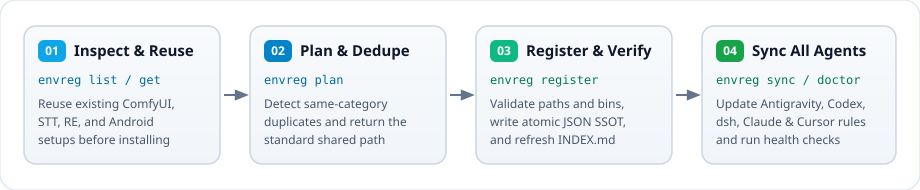

<div align="center">
  <br>
  
</div>
<p align="center"><a href="README.md">简体中文</a> | English</p>
<p align="center">
  <a href="https://nodejs.org/"></a>
  <a href="LICENSE"></a>
  <a href="https://github.com/yeye45/Agent-EnvShare/releases"></a>
  <a href="docs/install.md"></a>
</p>

**Register once. Share machine-level environments across sessions, workspaces, and AI agents.**

Agent-EnvShare (`envreg`) is an open-source, zero-dependency shared environment registry for AI coding agents. It keeps heavy, machine-singleton setups—such as base dev toolchains, ComfyUI, speech-to-text (STT/TTS), local LLMs, reverse-engineering kits, and Android SDKs—in a single local source of truth decoupled from your repositories, and automatically shares them across Antigravity, Codex, dsh (DeepSeek Harness), Claude Code, Cursor, and any CLI-capable agent.

[Quick start](#quick-start) · [Try sample data](#try-sample-data) · [AI install guide](docs/install.md) · [Agent instructions](skill/machine-env/SKILL.md) · [Schema](docs/schema.md)

[](assets/readme-workflow-en.svg)

## Quick start

Requires Node.js 20 or later with zero third-party dependencies. Code and machine data are decoupled: `envreg init` initializes your personal registry under `~/.machine-env` (or any custom directory you choose).

```bash
git clone https://github.com/yeye45/Agent-EnvShare.git
cd Agent-EnvShare
node bin/envreg.mjs init --shared-root /path/to/SharedEnvs
node bin/envreg.mjs setup
envreg --help
```

Or hand the installer guide directly to any AI coding agent to install and wire itself up:

```text
Install and configure Agent-EnvShare for me: https://raw.githubusercontent.com/yeye45/Agent-EnvShare/main/docs/install.md
```

If installing from a GitHub Release tarball, run `npm install -g ./agent-envshare-1.0.0.tgz`, followed by `envreg init` and `envreg setup`.

### Try sample data

Try the full workflow in an isolated temporary directory without touching your real home directory or existing agent configs.

```powershell
$demo = Join-Path $env:TEMP ("envreg-demo-" + [guid]::NewGuid().ToString("N").Substring(0,8))
New-Item -ItemType Directory -Force "$demo\sample-comfyui" | Out-Null
$env:ENVREG_HOME = $demo
node bin/envreg.mjs init --shared-root "$demo\SharedEnvs"
node bin/envreg.mjs register --id comfyui --name "ComfyUI Demo" --category ai-image --root "$demo\sample-comfyui" --summary "Local shared image generation demo" --no-sync
node bin/envreg.mjs list
node bin/envreg.mjs plan --category ai-image --name "New Image Gen"
node bin/envreg.mjs doctor
Remove-Item Env:ENVREG_HOME
```

## Workflow

1. **Initialize and wire up agents.** Run `envreg init --shared-root "D:\SharedEnvs"` to set the default root for newly created shared environments, run `envreg setup` to detect and connect Antigravity, Codex, dsh, Claude Code, Cursor, and `~/.agents`, then confirm with `envreg status`.
2. **Register existing heavy environments in-place.** Do not move working setups. Use `envreg register` to record root paths, executables, environment variables, shared model caches, service URLs/ports, and health checks. The CLI validates paths and uniqueness before writing atomic JSON records and refreshing `INDEX.md`.
3. **Plan and deduplicate before creating new ones.** Run `envreg plan --category <category> --name "<Name>"` before installing a new machine-singleton environment. It highlights existing environments in the same category to prefer reuse, and provides a standard path plus creation checklist to keep heavy environments out of project workspaces.
4. **Auto-sync and run health checks.** Every `envreg register` or `envreg update` refreshes the managed rule blocks across detected agents automatically. Run `envreg doctor` anytime to verify paths, executables, health commands, and TCP service ports.

Register an existing environment and run diagnostics:

```bash
envreg register \
  --id comfyui \
  --name "ComfyUI Image Generation" \
  --category ai-image \
  --root "/path/to/ComfyUI" \
  --summary "Local shared ComfyUI environment and API service" \
  --exec python="/path/to/ComfyUI/venv/bin/python" \
  --resource "/path/to/ComfyUI/models" \
  --url "http://127.0.0.1:8188" \
  --port 8188

envreg doctor
```

In any workspace or agent session, query or audit on demand:

```bash
# List all registered shared environments (add --json for machine-readable output)
envreg list

# Search by keyword and inspect executables, start commands, and notes
envreg search whisper
envreg get comfyui

# Audit all entries and mark broken paths automatically
envreg doctor --fix-status
```

Your data stays strictly local. Existing agent rules are never overwritten, and physical environment folders are never moved or deleted.

## Features

| Feature | Purpose |
| --- | --- |
| Single Source of Truth (SSOT) | One JSON record per environment with atomic writes, lockfile safety, and auto-generated `INDEX.md` |
| Multi-agent auto-setup | `setup` detects and wires Antigravity, Codex, dsh, Claude Code, Cursor, `~/.agents`, and more |
| Non-invasive managed blocks | Updates only the marked block inside global rule files and creates a `*.envreg.bak` backup on first touch |
| Deduplication and planning | `plan` flags similar existing environments and assigns standard shared directories outside business repos |
| Zero-dependency cross-platform CLI | Pure Node.js with ASCII-safe Windows launchers for non-ASCII paths and native POSIX support |
| Automated diagnostics | `doctor` verifies root paths, executables, custom health commands, and service TCP ports |
| Clean uninstall | `uninstall` removes only managed rule blocks and skill links without touching registry data or environments |

## More detail

See the [AI install guide](docs/install.md), [agent instructions](skill/machine-env/SKILL.md), [schema and environment variables](docs/schema.md), and [limits and safety notes](#limits-and-safety-notes). Adapter paths, fallback behavior, and boundaries are detailed below.

<details>
<summary>Advanced operations and safety boundaries</summary>

### Supported agents and paths

| Agent | Skill location | Global managed rule block |
| --- | --- | --- |
| Open Agent Skills | `~/.agents/skills/machine-env` | — |
| Antigravity | `~/.gemini/config/plugins/machine-env/skills/machine-env` | `~/.gemini/config/plugins/machine-env/rules/AGENTS.md` |
| OpenAI Codex | `~/.codex/skills/machine-env` | `~/.codex/AGENTS.md` |
| DeepSeek Harness (`dsh`) | `$DSH_HOME/skills/machine-env` | `$DSH_HOME/AGENTS.md` |
| Claude Code | `~/.claude/skills/machine-env` | `~/.claude/CLAUDE.md` |
| Cursor | `~/.cursor/skills/machine-env` | Via Skill + CLI |
| Gemini CLI / Windsurf / OpenCode | Auto-connected when config directory is detected | Corresponding global rule file |

Use `envreg setup --only codex,dsh` to target specific agents, or re-run `envreg setup` later after installing new agents.

### Symlinks and restricted-environment fallback

`envreg setup` prefers directory junctions on Windows (no Administrator rights required) and directory symlinks on macOS/Linux pointing to the single `skill/machine-env/` source. In restricted sandboxes or filesystems where symlinks are blocked (`EPERM` / `ENOTSUP`), it automatically falls back to a managed copy tagged with `.envreg-managed`, which `setup` and `uninstall` maintain safely.

### Environment variables

- `SHARED_ENV_REGISTRY`: Override the active registry directory per command.
- `ENVREG_HOME`: Override the home directory used for config and agent discovery.
- `ENVREG_BIN_DIR`: Override the global CLI shim output directory.
- `ENVREG_AGENT`: Default `updated_by` label when registering environments.
- `DSH_HOME`: DeepSeek Harness home directory (defaults to `~/.dsh`).

### Limits and safety notes

- `envreg remove` and `envreg uninstall` never delete physical environment directories; they only remove registry metadata or agent hooks.
- When a sandboxed agent runs `envreg register` without write permissions to external agent rule files, the core registry write still succeeds with a non-fatal notice; run `envreg sync` later to refresh external rule blocks.
- `envreg doctor` checks local TCP port reachability for service environments, but does not auto-start services or auto-repair broken dependencies.
- Automated tests are verified on Windows PowerShell 5.1 / CMD with Node.js 24; macOS and Linux paths follow POSIX conventions—run `npm test` on your target host after installation.

</details>

## Tests and release packaging

Run the isolated automated test suite (uses a temporary home directory and never touches real configs):

```bash
npm test
```

Build clean release artifacts into `dist/` (scans for personal path leaks and generates `.tgz`, `.zip`, and `SHA256SUMS.txt`):

```bash
npm run release:build
```

## License

[MIT](LICENSE)
