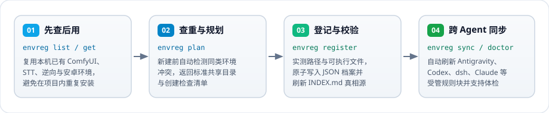

<div align="center">
  <br>
  
</div>
<p align="center">简体中文 | <a href="README.en.md">English</a></p>
<p align="center">
  <a href="https://nodejs.org/"></a>
  <a href="LICENSE"></a>
  <a href="https://github.com/yeye45/Agent-EnvShare/releases"></a>
  <a href="docs/install.md"></a>
</p>

**一次登记，跨会话、跨工作区、跨 Agent 复用本机共享环境。先查重，规范建，建完自动同步。**

Agent-EnvShare（CLI 命令 `envreg`）是面向多 AI 编程代理的开源本机共享环境注册表。它把电脑上“整机只需一份”的重型环境——例如基础开发工具链、ComfyUI 生图环境、语音转文本（STT/TTS）、本地大模型、逆向套件与安卓开发环境——收敛到一份独立于代码仓的本地真相源，并自动通过 `SKILL.md` 与受管规则块共享给 Antigravity、Codex、dsh（DeepSeek Harness）、Claude Code、Cursor 等多个 Agent。

[快速开始](#快速开始) · [试用样本](#试用样本) · [AI 一键安装](docs/install.md) · [代理规则](skill/machine-env/SKILL.md) · [数据结构](docs/schema.md)

[](assets/readme-workflow-zh.svg)

## 快速开始

需要 Node.js 20 或更新版本，无任何第三方运行依赖。代码与本机数据分离：安装后通过 `envreg init` 将个人环境清单初始化在用户目录（默认 `~/.machine-env`，也可指定任意目录）。

```bash
git clone https://github.com/yeye45/Agent-EnvShare.git
cd Agent-EnvShare
node bin/envreg.mjs init --shared-root /path/to/SharedEnvs
node bin/envreg.mjs setup
envreg --help
```

也可以直接把安装指南发给你的任意 AI Agent，让它自动完成安装与接入：

```text
帮我安装并配置 Agent-EnvShare：https://raw.githubusercontent.com/yeye45/Agent-EnvShare/main/docs/install.md
```

如通过 GitHub Release 的 `.tgz` 安装，只需执行 `npm install -g ./agent-envshare-1.0.0.tgz`，再运行 `envreg init` 与 `envreg setup`。

### 试用样本

在不触碰你真实主目录与现有 Agent 配置的前提下，用隔离临时目录体验完整流程。

```powershell
$demo = Join-Path $env:TEMP ("envreg-demo-" + [guid]::NewGuid().ToString("N").Substring(0,8))
New-Item -ItemType Directory -Force "$demo\sample-comfyui" | Out-Null
$env:ENVREG_HOME = $demo
node bin/envreg.mjs init --shared-root "$demo\SharedEnvs"
node bin/envreg.mjs register --id comfyui --name "ComfyUI Demo" --category ai-image --root "$demo\sample-comfyui" --summary "本地共享生图演示环境" --no-sync
node bin/envreg.mjs list
node bin/envreg.mjs plan --category ai-image --name "New Image Gen"
node bin/envreg.mjs doctor
Remove-Item Env:ENVREG_HOME
```

## 使用流程

1. **初始化并接入本机 Agent。** 运行 `envreg init --shared-root "D:\SharedEnvs"` 设定新建共享环境的默认根目录，再运行 `envreg setup` 自动探测并接入本机已安装的 Antigravity、Codex、dsh、Claude Code、Cursor 等工具，最后用 `envreg status` 核对接入状态。
2. **原位登记已有重型环境。** 已有环境无需搬家。通过 `envreg register` 录入根目录、关键可执行文件、环境变量、共享模型目录、服务端口与健康探针，工具会先校验路径存在与唯一性，再原子写入 JSON 档案并刷新 `INDEX.md`。
3. **新建前先查重与规划。** 当需要创建新的整机共享环境时，先运行 `envreg plan --category <分类> --name "<名称>"`。工具会列出同类已有环境提示优先复用，并给出符合规范的落盘目录和创建检查清单，防止建到临时工作区。
4. **跨 Agent 自动同步与巡检。** 每次 `envreg register` 或 `envreg update` 完成后，工具自动刷新所有已接入 Agent 的受管规则区块；随时运行 `envreg doctor` 可批量验证路径、可执行文件、健康命令与服务端口。

原位登记一个已有环境并体检的典型命令如下：

```powershell
envreg register `
  --id comfyui `
  --name "ComfyUI 生图环境" `
  --category ai-image `
  --root "D:\AI\ComfyUI" `
  --summary "本机共享 ComfyUI 生图与 API 服务" `
  --exec python="D:\AI\ComfyUI\venv\Scripts\python.exe" `
  --resource "D:\AI\ComfyUI\models" `
  --url "http://127.0.0.1:8188" `
  --port 8188

envreg doctor
```

平时在任意工作区或任意 Agent 会话中，只需按需查询、检索或巡检：

```powershell
# 查看全部已登记共享环境（支持 --json 供程序/Agent 解析）
envreg list

# 按关键词检索并查看完整路径、启动命令与避坑说明
envreg search whisper
envreg get comfyui

# 巡检所有环境，并自动把路径失效的环境状态更新为 broken
envreg doctor --fix-status
```

数据始终留在你的本地机器。原有 Agent 规则文件不会被覆盖，物理环境文件也不会被移动或删除。

## 功能一览

| 功能 | 用途 |
| --- | --- |
| 独立真相源（SSOT） | 一环境一 JSON 档案，原子写入加文件锁，自动生成可供任意工具直读的 `INDEX.md` |
| 多 Agent 自动接入 | `setup` 一键探测并接入 Antigravity、Codex、dsh、Claude Code、Cursor、`~/.agents` 等工具 |
| 无侵入受管规则块 | 仅维护注释标记区块内的极简规则与速览表，首次写入自动备份 `*.envreg.bak`，原有规则原样保留 |
| 查重与落盘规划 | `plan` 在新建前自动提示同类已有环境，并按分类分配标准共享目录，拦截临时目录与重复路径 |
| 跨平台零依赖 CLI | 纯 Node.js 实现，Windows 自动生成纯 ASCII 启动器避开中文路径编码问题，macOS/Linux 原生运行 |
| 自动化体检 | `doctor` 批量校验根目录、可执行文件、自定义健康命令与服务 TCP 端口，支持 `--fix-status` 自动更新状态 |
| 干净卸载与回滚 | `uninstall` 仅移除受管规则块与 Skill 联接，不删除注册表数据或任何物理环境 |

## 深入使用

查看 [AI 安装指南](docs/install.md)、[代理规则](skill/machine-env/SKILL.md)、[数据结构与环境变量](docs/schema.md) 和 [限制与安全说明](#限制与安全说明)。各 Agent 适配细节、受管区块机制及安全边界见下方折叠章节。

<details>
<summary>高级操作与安全边界</summary>

### 已适配 Agent 与接入位置

| Agent | Skill 分发位置 | 全局规则受管区块 |
| --- | --- | --- |
| Open Agent Skills | `~/.agents/skills/machine-env` | — |
| Antigravity | `~/.gemini/config/plugins/machine-env/skills/machine-env` | `~/.gemini/config/plugins/machine-env/rules/AGENTS.md` |
| OpenAI Codex | `~/.codex/skills/machine-env` | `~/.codex/AGENTS.md` |
| DeepSeek Harness (`dsh`) | `$DSH_HOME/skills/machine-env` | `$DSH_HOME/AGENTS.md` |
| Claude Code | `~/.claude/skills/machine-env` | `~/.claude/CLAUDE.md` |
| Cursor | `~/.cursor/skills/machine-env` | 通过 Skill + CLI 生效 |
| Gemini CLI / Windsurf / OpenCode | 检测到对应配置目录时自动接入 | 对应全局规则文件 |

运行 `envreg setup --only codex,dsh` 可只接入指定目标；电脑后续新装其他 Agent 后，再执行一次 `envreg setup` 即可自动纳管。

### 软链与权限受限降级

`envreg setup` 优先使用目录联接（Windows Junction，无需管理员权限）或目录软链（macOS/Linux）指向唯一一份 `skill/machine-env/` 源码。在受限沙盒、企业策略或不支持软链的文件系统上，工具会自动降级为带 `.envreg-managed` 标记的受管拷贝，并在后续 `setup` 与 `uninstall` 时安全维护。

### 多注册表与环境变量

- `SHARED_ENV_REGISTRY`：临时覆盖当前命令使用的注册表目录。
- `ENVREG_HOME`：覆盖配置与 Agent 探测主目录（便于隔离测试或便携部署）。
- `ENVREG_BIN_DIR`：覆盖全局 CLI 启动脚本安装目录。
- `ENVREG_AGENT`：指定登记时默认记录的 `updated_by` 来源标识。
- `DSH_HOME`：指定 DeepSeek Harness 主目录（默认 `~/.dsh`）。

### 限制与安全说明

- `envreg remove` 与 `envreg uninstall` 仅清理注册表记录或 Agent 接入配置，不会删除任何物理环境文件。
- 沙盒化 Agent 执行 `envreg register` 时，若无权写入外部 Agent 规则文件，核心注册表写入仍会正常成功并给出非致命提示，稍后运行 `envreg sync` 即可补齐外部同步。
- `envreg doctor` 对服务型环境仅做本地 TCP 端口连通性探测，不自动拉起后台服务，也不自动修复损坏依赖。
- 自动化测试已在 Windows PowerShell 5.1 / CMD 与 Node.js 24 环境实机验证；macOS 与 Linux 逻辑按 POSIX 规范实现，建议在目标系统首次安装后运行 `npm test` 复核。

</details>

## 测试与打包

运行自动化测试（在隔离临时目录执行，不触碰本机真实配置）：

```bash
npm test
```

构建干净的发布产物到 `dist/`（自动执行个人路径泄露扫描，生成 `.tgz`、`.zip` 与 `SHA256SUMS.txt`）：

```bash
npm run release:build
```

## License

[MIT](LICENSE)
